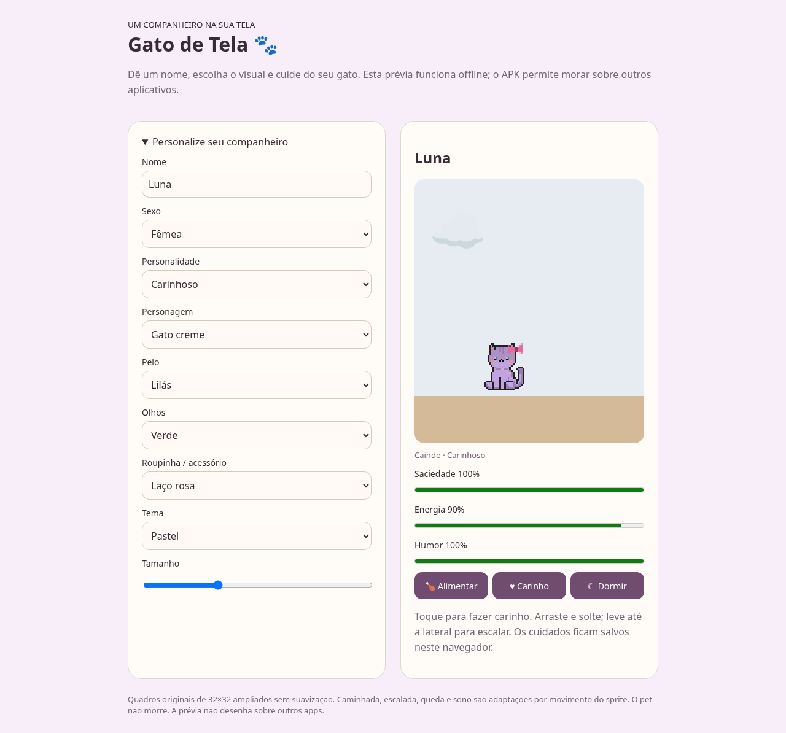

# Pet Screen 🐾 · fábrica de pets Android

**[Baixar APK pronto](https://github.com/sml98/Pet_Screen/releases/latest/download/Gato-de-Tela.apk)** · **[Baixar pack reunido](packs/ScreenPet-Packs-Completo.zip)** · **[Skill para agentes](skills/android-screen-pet/SKILL.md)** · **[Criar sua versão](docs/ADAPTAR-OUTRO-PACK.md)**

Exemplo reutilizável de pet virtual Android: seis gatos, fome, sono, carinho, humor, nome, sexo do perfil, cinco personalidades, cores, acessórios, temas e tamanho ajustável. O gato fica sobre outros apps e pausa a animação com a tela apagada.



## Uma base para vários apps personalizados

A skill pode receber uma ideia, procurar packs candidatos, verificar a arte e a licença, importar o personagem e gerar uma versão exclusiva com nome, ícone, identificador Android e perfil inicial próprios. Veja o [fluxo da fábrica de apps](docs/FABRICA-DE-APPS.md). As ferramentas de pesquisa auxiliam a descoberta; a escolha e a conferência da licença são feitas pelo agente.

## Usar como exemplo com qualquer agente

```bash
git clone https://github.com/sml98/Pet_Screen.git
cd Pet_Screen
```

Anexe um novo pack ao seu agente e peça:

> Leia `AGENTS.md` e siga `skills/android-screen-pet/SKILL.md`. Crie minha versão do pet com os personagens anexados e entregue um APK assinado pronto para instalar, uma prévia offline e o código.

O catálogo é configurável em `app/src/main/assets/pets.json`; Android e prévia acompanham os personagens adicionados pelo importador. As ferramentas aceitam quadros retangulares e normalizam grades regulares sem esticar. Veja o [passo a passo completo](docs/ADAPTAR-OUTRO-PACK.md).

## Packs reunidos

O [ZIP completo](packs/ScreenPet-Packs-Completo.zip) reúne os quatro packs recebidos, 26 arquivos fonte, 12 folhas ampliadas em 4×/8× e um índice JSON com dimensões e hashes. [Consulte a origem e a situação das licenças das artes](packs/ORIGEM-E-LICENCAS.md): os ZIPs não trouxeram termos de licença, e a licença MIT do código não se estende a esses assets.

App Android nativo em Java, Android 8.0 ou superior, sem bibliotecas de terceiros e sem permissão de internet. A pasta `preview` contém uma demonstração HTML independente e offline.

## Instalar no celular

1. Baixe `Gato-de-Tela.apk` e abra o arquivo. Se o Android solicitar, permita instalar apps por esse navegador ou gerenciador de arquivos.
2. Abra **Gato de Tela**, toque em **Permitir sobreposição** e ative **Aparecer sobre outros apps**.
3. Escolha nome, sexo, personalidade, personagem, cores, acessório, tema e tamanho. Toque em **Salvar e iniciar / atualizar gato**.
4. Toque no gato para fazer carinho e abrir os cuidados. Arraste e solte para brincar; solte junto à lateral para escalar.
5. Pare pela tela do app ou pela ação **Parar** da notificação. Após reiniciar o celular, inicie o gato novamente pelo app.

O APK release tem assinatura própria do projeto. Não é uma publicação na Play Store. Alguns fabricantes restringem sobreposições ou encerram serviços em segundo plano; confira as permissões de bateria no aparelho. Telas seguras e alguns apps podem ocultar overlays por decisão do Android.

## Cuidados e personalização

- Saciedade cai 6 pontos/hora; energia cai 8 pontos/hora acordado e recupera 28/hora dormindo; humor cai 3 pontos/hora. O cálculo de ausência limita-se a 24h. Nenhuma necessidade causa morte.
- Alimentar recupera 25 de saciedade e 5 de humor. Carinho aumenta humor, mostra coração e abre o menu quando feito por toque.
- Bravo: ganho menor com carinho e coração breve. Carinhoso: ganho maior com carinho. Fofo: coração por mais tempo. Preguiçoso: passeios mais curtos, descanso maior e sono antecipado. Equilibrado: parâmetros padrão.
- Nome, sexo e aparência são do mesmo pet: trocar o personagem não cria outro histórico de cuidados. Sexo é informação do perfil, sem reprodução ou diferenças de comportamento.
- Seis personagens: creme, vampiro, caixa, caixa Halloween, bruxo na vassoura, vampiro bravo. As cores modificam apenas pixels compatíveis da paleta; cores originais escuras e detalhes das fantasias são preservados. Os olhos recoloridos e acessórios desenhados destinam-se aos quadros de 32×32. O bruxo mantém olhos e fantasia originais e não recebe acessórios extras para preservar a arte retangular.
- Temas de cuidados: Aconchegante e Pastel a partir de UIBundleFree; Fantasia a partir de FantasyUIfree. Mantemos controles nativos legíveis sobre as molduras recortadas.

## Animação e resolução

Consulte `sprite-manifest.json` para dimensões, frames e origem do exemplo, e `app/src/main/assets/pets.json` para o catálogo que controla o runtime. Os oito estados essenciais são implementados: idle, walk, climb, hang, fall, land, sit e drag; há também sleep. O pack não oferece sequências dedicadas para todos esses estados: o motor combina as folhas existentes com deslocamento, inclinação e squash. A escalada e o hang são adaptações estilizadas; não há desenho original de mãos agarrando o teto.

O bruxo usa 6 quadros de 48×64, preservados sem esticar; os demais gatos usam 32×32. O chão ancora o limite inferior do quadro e o teto o superior; margens transparentes originais são preservadas. Sprites 4× e 8× em `assets-hd` usam nearest-neighbor: mais pixels, sem inventar detalhes. O Android escala diretamente os originais sem suavização, mantendo nitidez e permitindo 56–160 dp.

## Overlay e bateria

Serviço foreground com `TYPE_APPLICATION_OVERLAY`, notificação persistente e ação Parar. Janela apenas do tamanho do pet, com `FLAG_NOT_FOCUSABLE` e `FLAG_NOT_TOUCH_MODAL`: toques fora dela continuam chegando aos outros apps. O pequeno retângulo transparente que pertence ao sprite recebe toque para permitir arrasto. O painel de cuidados é outra janela pequena, fechada explicitamente pelo botão Fechar.

O serviço cancela o loop no evento de tela apagada, retoma no evento de tela acesa e calcula necessidades pelo relógio. Não usa wake lock. As necessidades são salvas em SharedPreferences a cada 30s, nas ações e ao desligar a tela/encerrar o serviço. Uma interrupção abrupta pode perder até 30s de estado.

## Compilar

Requer JDK 17, Android SDK 35 e Gradle 8.9. Abra a pasta no Android Studio ou execute `./gradlew assembleDebug` (Windows: `gradlew.bat assembleDebug`). O wrapper Gradle 8.9 está incluído.

A automação `.github/workflows/android.yml` gera um APK debug instalável em cada push em main/master ou execução manual, seguida de um smoke test Android 15 em emulador com KVM. Baixe o artefato na aba Actions. Para release estável, configure os secrets:

- `ANDROID_KEYSTORE_BASE64`: keystore codificado em base64, em uma única linha.
- `ANDROID_KEYSTORE_PASSWORD`, `ANDROID_KEY_ALIAS`, `ANDROID_KEY_PASSWORD`.

O backup de assinatura entregue separadamente contém a chave e credenciais criadas para este app. Guarde-o em local privado, fora do repositório. A mesma chave permite atualizar o app sem desinstalar e perder os cuidados salvos. Sem esses secrets o fluxo gera apenas debug; a chave debug dos runners não é uma identidade estável para atualizações.

Para release local configure `RELEASE_STORE_FILE`, `RELEASE_STORE_PASSWORD`, `RELEASE_KEY_ALIAS`, `RELEASE_KEY_PASSWORD` e execute `./gradlew assembleRelease`.

## Fontes dos assets

Arquivos fornecidos pelo usuário: CatPackFree.zip, CatPackHalloweenFREE.zip, UIBundleFree.zip e FantasyUIfree.zip. Preservados em `original/` e `extra-packs/`; os ZIPs não incluíam texto de licença. Verifique os termos do autor antes de publicar ou redistribuir comercialmente. Acessórios adicionais e código foram criados para este projeto.

## Verificação

`VERIFICACAO.md` registra os testes realizados e as limitações. A prévia HTML usa armazenamento local próprio, sem sincronizar com o app Android.
